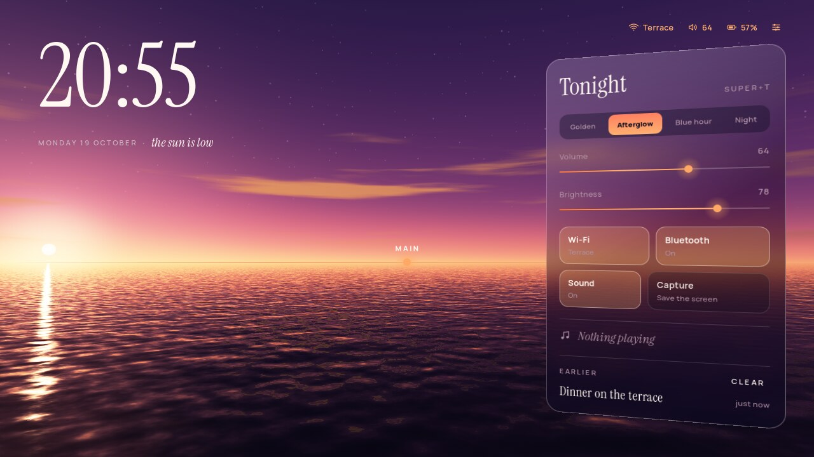

# Horizon



shady-shell living in [Afterglow](https://github.com/gloaming-dusk/shady-rice-afterglow)'s sky. There is no
bar:

- the time is written large across the sky, with a line that follows the
  hour ("the sun is low", "the blue hour", ...),
- the workspaces are lights sitting on the horizon (the current one bright,
  ones with windows lit, empty ones faint) and the open windows are
  reflected in the sea just below it: click to focus, middle-click to close,
- a single line of text in the top-right sky shows Wi-Fi, volume and
  battery; clicking it brings up the control center,
- the control center is a slab of frosted glass standing in the air, turned
  towards the middle of the screen in 3D. It picks the hour of the sky
  (golden, afterglow, blue hour, night), sets volume and brightness, toggles
  Wi-Fi, Bluetooth and sound, takes a screenshot and shows what is playing,
- the launcher (`Super+d`) scatters every application across the sky as a
  star. Type a name and the matching stars light up and join into a
  constellation; `Tab` moves to the next one, `↵` launches it.
- notifications appear as words in the sky under the status line, on a
  faint frosted card; the control center lists them under "Earlier".

Every colour follows the sky's published palette, so the whole shell
cross-fades with `Super+T`.

## Use it

Horizon needs [Shady](https://github.com/gloaming-dusk/shady),
[shady-shell](https://github.com/gloaming-dusk/shady-shell) and
[Afterglow](https://github.com/gloaming-dusk/shady-rice-afterglow), whose
`config.lua` and `init.lua` it starts from (`shady.base("afterglow")`).

On NixOS, add this flake's package and Afterglow's to `programs.shady.rices`
and set `programs.shady.rice = "horizon";`. Elsewhere, `./install.sh` here
and in an Afterglow checkout, then `SHADY_RICE=horizon`.

To try it from a checkout, next to built `shady`, `shady-shell` and
`shady-rice-afterglow` checkouts (or with `SHADY_ROOT`, `SHADY_SHELL_BIN`
and `SHADY_AFTERGLOW_DIR` pointing at them):

```bash
nix develop ../shady -c ./run.sh          # nested in a Wayland session
nix develop ../shady -c ./run-native.sh   # directly on a VT (DRM + libinput)
```

Its `config.lua` and `init.lua` load
Afterglow's (sky plugin, sea, camera, window style and key bindings);
`init.lua` adds the glass and the 3D turn of the control center. The control center's tools are the
same optional ones as in the Objects rice: `wpctl`, `brightnessctl`,
`nmcli`, `bluetoothctl`, `playerctl` and `grim`.

The desk (clock, horizon, reflections) is a background-level layer, so
windows cover it; the status line stays above them.

The screenshots, the four hours and the website's hero loop come from
`capture.sh`, which runs the rice headless on a private session bus with
stand-ins for the system tools and a fixed set of applications
(`capture/`):

```bash
nix develop ../shady -c ./capture.sh
```

Typefaces: [Instrument Serif](https://github.com/Instrument/instrument-serif)
and [Manrope](https://github.com/googlefonts/manrope), both under the SIL Open
Font License 1.1 (`fonts/OFL-*.txt`).
